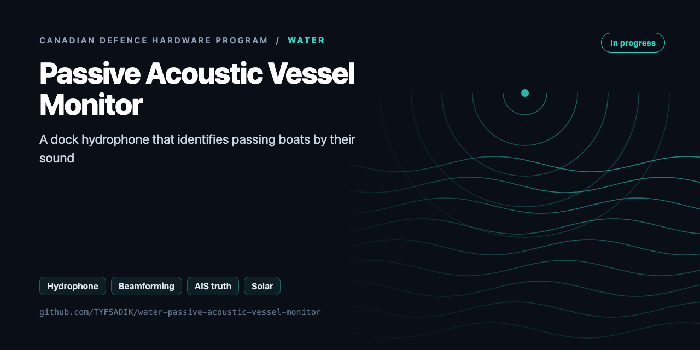
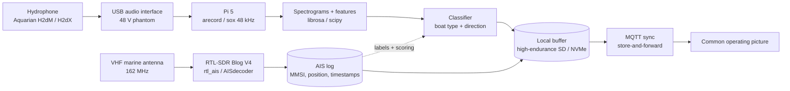

<div align="center">



# Water: Passive Acoustic Vessel Monitor

**Dock-mounted hydrophone node that detects and classifies passing vessels from underwater sound, with an RTL-SDR AIS receiver as ground truth, solar powered.**

[](https://github.com/TYFSADIK/water-passive-acoustic-vessel-monitor/actions/workflows/tests.yml)   [](LICENSE) [](https://github.com/TYFSADIK/defence-hardware-program)

[Build guide](docs/project-page.md) · [How it works](#how-it-works) · [Quick start](#quick-start) · [Program hub](https://github.com/TYFSADIK/defence-hardware-program)

</div>

## Overview

This is the water node of my [defence hardware program](https://github.com/TYFSADIK/defence-hardware-program): a hydrophone hanging off a dock (or, later, a mooring), a Raspberry Pi 5 that records and classifies what it hears, and a cheap AIS receiver that tells me what actually went past so the classifier can be trained and scored against reality. Every vessel passage becomes a labelled acoustic event: spectrogram in, vessel class and direction out.

The Canadian context is direct. The **Canadian Arctic Sensor Suite Initiative** aims for persistent surveillance from seabed to space, and the underwater leg of that is the hard one. DRDC's **Northern Watch** demonstration ran into problems with installation, ice, technical issues, and data management, the unglamorous parts, not the sensing itself. And in DRDC-linked work at Dalhousie, uncrewed vehicles act as sensor hosts that dock at seabed nodes to recharge and download data, while other DRDC-related work pairs hydrophone arrays with AIS data and ferry GPS as a reference. This build copies exactly those two patterns at hobby scale: AIS as the labelling source, and a dock-and-upload extension as the roadmap.

The sensing path emits nothing. It listens to the water and listens to the 162 MHz AIS band, both receive-only, which keeps it legal, low-power, and hard to detect; the sync uplink transmits only when a link appears. What it practices is the layer Northern Watch struggled with: cheap nodes that stay alive, manage their own data, and sync when a link finally appears.

## How it works



*Two receive-only sensors feed the Pi; the AIS stream labels and scores the acoustic classifier; everything buffers locally and syncs over MQTT when a link exists.*

## Quick start

```bash
pip install numpy
python demo.py && python -m unittest -v
```

Real output from the demo, run on simulated data:

```text
true 900 RPM / 3 blades -> est 900 RPM / 3 blades (blade rate 45.0 Hz)
true 150 RPM / 5 blades -> est 150 RPM / 5 blades (blade rate 12.5 Hz)
Position(mmsi=366053209, lat=37.80211833333333, lon=-122.34161833333333, sog_kn=0.0, cog=219.3, heading=1)
[{'t': 1000, 'mmsi': 316001234, 'label': 'tug', 'range_m': 396}, {'t': 5000, 'mmsi': None, 'label': 'unlabelled'}]
```

## What's in this repo

| File | Purpose |
|---|---|
| `hydro/dsp.py` | Broadband detector (running-median floor), LOFAR spectrogram, and **DEMON** envelope spectrum with a harmonic sieve to get **shaft RPM and blade count** |
| `hydro/ais.py` | AIS `!AIVDM` decoder (types 1-3 position, type 5 static with multi-fragment reassembly), NMEA checksum, ship-type classes, UDP listener for rtl-ais or AIS-catcher |
| `hydro/labels.py` | AIS as the labelling machine: closest-approach events, then labelled acoustic detections. Boats without AIS stay `unlabelled` |
| `hydro/capture.py` | 24-bit FLAC capture in UTC-named chunks |

## What you need

| Category | Item | Notes |
|----|----|----|
| Hardware | Hydrophone + USB audio interface | H2d-class hydrophone (XLR needs 48 V phantom, 3.5 mm variant needs none); interface must hold -12 dBFS peaks without clipping |
| Hardware | Raspberry Pi 5 | Capture, feature extraction, and the random-forest classifier all run on the node |
| Hardware | RTL-SDR Blog V4 + 162 MHz marine antenna | Both AIS channels at once; mount the antenna high with line of sight |
| Hardware | Field housing and power | IP67 box with glands, weighted hydrophone assembly, 12 V LiFePO4 battery, 30-50 W panel, MPPT controller, 5.1 V buck |
| Software | arecord/sox, rtl_ais or AISdecoder | Capture tooling and the AIS demodulator built from source |
| Software | librosa, scikit-learn, SQLite | Mel spectrograms, the random-forest classifier, and the truth database |
| Software | mosquitto, systemd | QoS 1 signed MQTT publishing, service supervision plus the Pi hardware watchdog |
| Skills | Linux audio, basic DSP, RF basics | ALSA gain staging, reading spectrograms, AIS message structure, power budgeting |
| Accounts | None | No accounts or licenses required for a receive-only acoustic and AIS receiver |

## Status

- **Done**: all components purchased and on the bench; capture chain working at 48 kHz (96 kHz exploratory) through the USB interface; test-tank rig assembled; rtl_ais decoding live AIS traffic with MMSI/position/timestamp logging into SQLite; spectrogram + blade-line feature pipeline running on the Pi 5; systemd recorder with watchdog on the bench image.
- **In progress**: T1-T3 bench test runs; labelling join between acoustic events and AIS tracks; first classifier training as the labelled dataset accumulates; IP67 housing, weighted hydrophone assembly, and MPPT power logging.
- **Next**: solar/MPPT field integration and first dock deployment (T4); AIS-scored detection-rate runs and classifier confusion matrix (T5); MQTT sync into the common operating picture; then the autonomous-boat docking-node extension.

| Run | Target | Measured to date | Current status |
|----|----|----|----|
| T1 capture soak | 0 dropped buffers over 12 h | Not yet measured | In progress, overnight soaks running |
| T2 tank replay | Sweep visible 100 Hz-20 kHz; stable noise floor | Not yet measured | In progress, replay sessions on the bench |
| T3 AIS decode | \>95% checksum-valid sentences; sampled MMSIs match public tracks | Not yet measured | In progress, logging and spot-checking |
| T4 detection vs AIS | ≥80% in-gate passages detected; \<2 false events/hour | No data, field collection not started | Not started, awaiting dock deployment |
| T5 classifier + sync | ≥80% macro recall; 100% backlog delivery on resync | No data, needs the T4 dataset | Not started, needs the T4 dataset |

## Roadmap

- [ ] T2 tank test: play known tones and modulated noise, and check the DEMON lines
- [ ] Run `rtl_ais -n` (or AIS-catcher) on the roof antenna and feed `ais.listen()` into a track store
- [ ] T4 field season: log broadband detections, label them with `labels.py`, and record range at first detection vs vessel class
- [ ] Classifier on [DEMON lines, RPM, blades, broadband level, LOFAR tonals]: gradient boosting first, then a small CNN on log-mel spectrograms once you have a few hundred labelled passes
- [ ] T5 sync-loss test: GPS PPS + chrony on the Pi, since a timing offset between audio and AIS corrupts the labels

## Related builds

- [Canadian Defence Hardware Program](https://github.com/TYFSADIK/defence-hardware-program), the program hub; this is the water node (Phase 2).
- [Multi-Domain Common Operating Picture](https://github.com/TYFSADIK/multi-domain-common-operating-picture), where this node's signed detections end up.
- [DDIL-Proof DevOps](https://github.com/TYFSADIK/ddil-proof-devops), the store-and-forward patterns the field sync reuses.
- [Arctic Domain Awareness Digital Twin](https://github.com/TYFSADIK/arctic-domain-awareness), the same AIS-as-truth idea over open data at Arctic scale.

## Learn more

The full build guide, with step-by-step instructions, wiring, troubleshooting and lessons learned, is in [docs/project-page.md](docs/project-page.md). It is also published at [tyfsadik.org](https://tyfsadik.org/work/defence/water-passive-acoustic-vessel-monitor.html).

## License

[MIT](LICENSE). Built by [Taki Sadik](https://tyfsadik.org) as part of the self-funded [Canadian Defence Hardware Program](https://github.com/TYFSADIK/defence-hardware-program).
