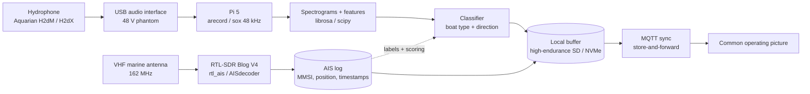
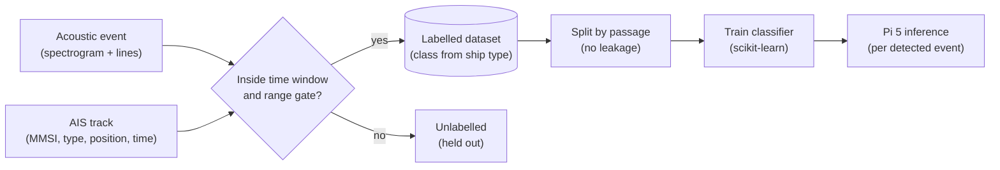

# Water: Passive Acoustic Vessel Monitor

Written by [Taki Sadik](https://tyfsadik.org/about.html) · Last updated 2026-10-22 · 31 min read

A dock-mounted hydrophone node that listens to the water, detects and classifies passing vessels from their machinery and propeller signatures, and uses an RTL-SDR AIS receiver as ground truth, solar powered, receive-only on the sensing side, and built to buffer through dead links.

## Overview

This is the water node of my [defence hardware program](https://github.com/TYFSADIK/defence-hardware-program): a hydrophone hanging off a dock (or, later, a mooring), a Raspberry Pi 5 that records and classifies what it hears, and a cheap AIS receiver that tells me what actually went past so the classifier can be trained and scored against reality. Every vessel passage becomes a labelled acoustic event: spectrogram in, vessel class and direction out.

The Canadian context is direct. The **Canadian Arctic Sensor Suite Initiative** aims for persistent surveillance from seabed to space, and the underwater leg of that is the hard one. DRDC's **Northern Watch** demonstration ran into problems with installation, ice, technical issues, and data management, the unglamorous parts, not the sensing itself. And in DRDC-linked work at Dalhousie, uncrewed vehicles act as sensor hosts that dock at seabed nodes to recharge and download data, while other DRDC-related work pairs hydrophone arrays with AIS data and ferry GPS as a reference. This build copies exactly those two patterns at hobby scale: AIS as the labelling source, and a dock-and-upload extension as the roadmap.

The sensing path emits nothing. It listens to the water and listens to the 162 MHz AIS band, both receive-only, which keeps it legal, low-power, and hard to detect; the sync uplink transmits only when a link appears. What it practices is the layer Northern Watch struggled with: cheap nodes that stay alive, manage their own data, and sync when a link finally appears.

## Bill of Materials

| Part | Role | Details | Est. US\$ |
|----|----|----|----|
| Hydrophone | Underwater ears | Aquarian H2dM (3.5 mm, needs plug-in power) or H2dX (XLR, needs 48 V phantom); -172 (H2dM) / -165 (H2dX) dB re 1 V/µPa (±4 dB 20 Hz-4 kHz) | 230-320 |
| Audio interface | Capture front end | USB interface with 48 V phantom power (required for XLR version) | 120-180 |
| Compute | Recording and inference | Pi 5 4 GB, active cooler, case | ~105 |
| AIS receiver | Independent ground truth | RTL-SDR Blog V4 + VHF marine antenna (162 MHz) | 60-90 |
| Housing | Field survival | IP67 box, cable glands, hydrophone weight assembly | 40-70 |
| Power | Unattended field power | 12 V battery, 30-50 W solar panel, MPPT controller, DC-DC buck | 150-250 |

All components are already purchased and on my bench. Total lands around US\$700-1,000 before tax and shipping.

## Architecture

Figure 1: two receive-only sensors feed the Pi; the AIS stream labels and scores the acoustic classifier; everything buffers locally and syncs over MQTT when a link exists.

## Reading a Vessel in Sound

A passing vessel is not one sound, it is a bundle of **stable machinery signatures**. The propeller draws narrowband **blade-rate lines**: tonals at the shaft rotation rate times the blade count, plus harmonics, and they hold steady for as long as the engine holds its throttle. Engines and gearboxes add their own low-frequency tonals. The classifier's job is to find that bundle on a spectrogram and match it to a vessel type; direction comes from the **Doppler slope** and the amplitude envelope. An approaching vessel's lines arrive upshifted in frequency and keep rising in level; they relax down through the closest point of approach and fade as it departs. That rise-and-fall, plus the sign of the Doppler, is how one hydrophone can infer which way a boat went, a radial trend only, approaching versus departing, under favourable conditions (steady course, low reverberation), without any bearing sensor. This is a radial trend, not a compass bearing: a single hydrophone cannot measure bearing, and no bearing estimate is published. Whether a given vessel is detectable at a given range follows the passive sonar equation: source level minus transmission loss must clear the ambient noise after the array's directivity, processing gain, and the detection threshold. Underwater sound speed, which shapes transmission loss, varies with temperature, salinity, pressure, and depth.

The chain records at 48 kHz as the defensible baseline, with 96 kHz explicitly exploratory: small-boat outboard blade-rate harmonics live in the low-kilohertz band, inside the Aquarian's approximately flat 20 Hz to 4 kHz sensitivity range, and useful small-outboard content above 20 kHz is not established, so the higher rate is not required. A 48 kHz chain keeps the interface's anti-alias filter well clear of the band of interest without paying for bandwidth the classifier cannot justify.

**Figure:** an illustrative Doppler/envelope timeline for one passage, not measured data. Blade-rate lines arrive upshifted and rising, relax through the closest point of approach, and fade. The tank replays (T2) verify the chain can render this shape from a known input before any field deployment.

## Wiring & Connections

| From | To | Cable / interface | Notes |
|----|----|----|----|
| Hydrophone (H2d-XLR) | USB audio interface, XLR input | Balanced XLR, 3 m stock cable | 48 V phantom power ON. The H2dM variant is 3.5 mm TRS into a mic input with plug-in power ON instead, phantom OFF. |
| USB audio interface | Pi 5 USB-A | USB 2.0 cable | Shows up as an ALSA card; the index varies with boot order, so the recorder addresses it by card name (see Troubleshooting). |
| RTL-SDR Blog V4 | Pi 5 USB-A | Direct, on a short USB extension | The extension moves the dongle away from the Pi's USB/HDMI noise and keeps it off the audio interface's port pair. |
| VHF marine antenna | RTL-SDR | RG-58 coax, BNC-to-SMA adapter | 162 MHz; mounted outside, above roofline, coax drip loop before the gland. |
| Hydrophone cable | IP67 box | Cable gland sized to the cable OD | Gland on the bottom face of the box so it never sits in pooled water; weight assembly on the hydrophone lead below the dock. |
| Solar panel (30-50 W) | MPPT controller PV input | 2-core 16 AWG | Fused at the panel, separate from the battery fuse. |
| MPPT controller | 12 V battery | Fused 14 AWG | Battery profile set to LiFePO4 on the controller; charge current logged for a week before field trust. |
| 12 V battery | DC-DC buck converter | Fused 16 AWG | Buck output adjusted to 5.1 V under full load before the Pi is ever connected. |
| DC-DC buck | Pi 5 | Short USB-C cable (or 18 AWG to GPIO 5 V/GND) | Powering via the header skips PD negotiation; voltage verified at the header pins, not at the buck output. |
| Pi 5 | Uplink (MQTT broker) | Ethernet to a field router, or Wi-Fi | Optional by design, the node runs fully disconnected and syncs later. |

## How I Built It

The hydrophone feeds a USB audio interface, which the Pi 5 sees as a standard ALSA capture device, no drivers to write, no vendor software. For the XLR H2dX I enable the interface's 48 V phantom power; the 3.5 mm H2dM needs plug-in power (mic bias) from the interface's mic input instead, not phantom. Recording is plain Linux tooling at 48 kHz, the defensible baseline (96 kHz stays exploratory). The higher rate keeps the interface's anti-alias filter well clear of the band of interest; blade-rate harmonics of small outboards live in the low-kilohertz band, which is inside the H2d's linear range, while ultrasonic content arrives heavily attenuated (Aquarian rates the H2d's sensitivity about 40 dB down at 100 kHz, and the newer A5 is high-frequency filtered, which is why the A5 is not the pick here).

**Find the interface, record 10 seconds at 48 khz, check levels**

    arecord -l
    arecord -D hw:CARD=USBAudio -f S32_LE -c 1 -r 48000 -d 10 tank_test.wav
    sox tank_test.wav -n stat

Gain staging happens in `alsamixer`: I set the interface gain so a loud tank signal peaks around -12 dBFS, leaving headroom for a real vessel at close range. Verified from the `sox ... stat` output: healthy RMS level, "Maximum amplitude" well under 1.0 (no clipping). What can go wrong here is phantom power left off on the XLR path, you get a silent file that still looks like a successful recording.

Before any field deployment, the whole chain gets validated in the glass test tank on my bench, the setup. I play swept tones and recorded vessel signatures through a speaker coupled to the tank, then confirm the captured spectrogram shows what was played. If the chain cannot hear a known signal in a tank, it has no business on a dock.

**Generate reference signals and measure the noise floor**

    sox -n sweep.wav synth 30 sine 100-20000
    sox -n boatsig.wav synth 60 brownnoise lowpass 800 gain -6
    play boatsig.wav
    # quiet 60 s capture with nothing playing:
    sox quiet_60s.wav -n stat 2>&1 | grep -E 'RMS|Maximum'

Verified by eyeballing the sweep on the live spectrogram (a clean diagonal from 100 Hz to 20 kHz) and by comparing the quiet-capture RMS against the with-signal RMS, the gap between them is the tank's usable dynamic range. The classic failure is the room's 60 Hz mains hum and its harmonics polluting the low end; see Troubleshooting.

The RTL-SDR Blog V4 with a 162 MHz marine antenna covers both AIS channels (161.975 and 162.025 MHz) at once. I run `rtl_ais`, a small C decoder built from source, which demodulates the two channels and emits standard NMEA `!AIVDM` sentences over UDP; `AISdecoder` is the alternative I keep around for comparison. Every decoded position report is logged with MMSI, position, speed over ground, course, and timestamp.

**Build rtl_ais and start the decoder**

    git clone https://github.com/dgiardini/rtl-ais
    cd rtl-ais && make
    ./rtl_ais -d 0 -h 127.0.0.1 -P 10110

**Capture the nmea stream to a log file**

    mkdir -p /var/log/ais
    nc -lu 10110 >> /var/log/ais/nmea.log

A small Python daemon parses the sentences, assembles multi-line messages, and writes one row per position report into a SQLite database. Verified by tailing the NMEA log and matching a decoded MMSI against a public AIS web map, same vessel, same place, same time. What can go wrong: an indoor antenna decodes almost nothing; AIS is short-range VHF and wants height and line of sight.

The AIS log is the labelling machine, with one hard limit: it only labels AIS-equipped traffic. Small boats that carry no transponder never appear in it, so the small-craft classes start unlabeled and need manual logs, camera, or schedule data instead. A strong acoustic event whose time window lines up with an AIS track passing inside the node's listening gate becomes a labelled sample, vessel class from the AIS static data (ship type field), approach-versus-departure from the range trend of the track. This mirrors the DRDC-related work that pairs hydrophone arrays with AIS and ferry GPS as ground truth, minus the budget.

**Join acoustic events to ais positions (python + sqlite)**

    import sqlite3
    db = sqlite3.connect("/data/ais/truth.db")
    q = """
    SELECT e.id, e.t_event, a.mmsi, a.lat, a.lon, a.sog, a.ship_type
    FROM events e
    JOIN ais a ON a.ts BETWEEN e.t_event - :pre AND e.t_event + :post
    """
    rows = db.execute(q, {"pre": 300, "post": 300}).fetchall()
    # keep matches inside the range gate (haversine to the node), nearest-in-time wins

Verified by hand-checking the first dozen labels against the audio, you can hear the Doppler sweep line up with the closest point of approach in the track. The failure mode to watch: two vessels overlapping in the window, which I resolve by keeping both candidate labels and flagging the sample as ambiguous instead of guessing.

Every detected event (a window where the energy envelope crosses threshold) becomes a feature set. The main feature is a mel spectrogram computed with `librosa`; alongside it, `scipy.signal` tracks narrowband propeller blade-rate lines, which are stable per engine and carry a lot of class information. Direction comes free from physics: an approaching vessel's lines show a slight Doppler upshift that relaxes downward at closest point of approach, while the amplitude envelope rises and falls.

**Spectrogram + line tracking for one event**

    import librosa, numpy as np
    from scipy.signal import spectrogram, find_peaks

    y, sr = librosa.load("event_0042.wav", sr=48000, mono=True)
    S = librosa.feature.melspectrogram(y=y, sr=sr, n_fft=4096,
                                       hop_length=1024, n_mels=128, fmax=20000)
    S_db = librosa.power_to_db(S, ref=np.max)

    f, t, Z = spectrogram(y, fs=sr, nperseg=8192)
    peaks, _ = find_peaks(Z[:, t.size // 2], prominence=10)
    blade_lines_hz = f[peaks]  # stable narrowband lines for this event

Verified by plotting `S_db` next to the raw waveform for a labelled sample and confirming the blade lines sit where the AIS class says they should (a slow diesel's lines are low and dense; an outboard's are higher). What can go wrong: tank echoes smear the lines on the bench, so line-tracking thresholds get tuned on field audio, not tank audio.

The classifier is deliberately small, it has to run on the Pi 5 between recordings with power to spare. A random forest over the spectrogram statistics plus the blade-line features is the current choice: trains in seconds, infers in milliseconds, and returns a confidence I can threshold. Deep models are a later experiment, only if the simple one plateaus.

**Train, export, and score (scikit-learn)**

    from sklearn.ensemble import RandomForestClassifier
    from sklearn.model_selection import train_test_split
    import joblib

    X_train, X_test, y_train, y_test = train_test_split(
        X, y, test_size=0.2, stratify=y, random_state=7)
    clf = RandomForestClassifier(n_estimators=200, max_depth=12, n_jobs=4)
    clf.fit(X_train, y_train)
    print(clf.score(X_test, y_test))
    joblib.dump(clf, "vessel_clf.joblib")

On the node, the same `joblib` file loads once at boot and scores each event; direction is a separate two-class decision from the Doppler sign and envelope slope: a radial approaching-versus-departing trend, valid only under favourable conditions, never a compass bearing. Verified by scoring the held-out test split on the Pi itself, not the laptop, so the accuracy I see is the accuracy the field hardware delivers. The thing that can go wrong is dataset leakage, events from the same vessel passage landing in both train and test, so I split by passage, not by event.

Field kit is an IP67 box with cable glands for the hydrophone lead, antenna coax, and solar input, all on the bottom face. The hydrophone hangs on a weighted assembly so it sits below the surface and away from dock slap. Power is a 12 V battery charged by a 30-50 W panel through an MPPT controller, with a DC-DC buck delivering a solid 5.1 V to the Pi 5, sized for grey Canadian weeks, not best-case sun.

**Power budget (engineering estimates, then sized)**

    Pi 5, recording + inference bursts   ~6-8 W peak, ~4 W typical
    USB audio interface (bus powered)    ~2.5 W
    RTL-SDR Blog V4                      ~1.5 W
    --------------------------------------------------------
    continuous draw                      ~8 W  ->  ~190 Wh/day
    12 V 50 Ah LiFePO4, 80% usable       ~480 Wh -> ~2.5 days reserve
    40 W panel, ~3 sun-hours (poor day)  ~120 Wh/day -> deficit
    40 W panel, summer day               covers load + recharges

The honest conclusion from the budget: one 40 W class panel is marginal through a dark Canadian December, so the panel is oversized relative to summer need and the battery carries the grey weeks. Verified by logging battery voltage and charge current from the MPPT's data output for a full week before trusting it in the field. What can go wrong: the buck drifts under load and the Pi browns out mid-write, the buck is set to 5.1 V measured at the Pi's header with everything running, not on the bench with nothing attached.

Detections, classifier confidence, and short audio snippets buffer locally on high-endurance storage (microSD now, NVMe on the M.2 HAT as the dataset grows). A sync daemon watches an outbox directory; when a link exists it publishes signed detection messages over MQTT to the [multi-domain common operating picture](https://github.com/TYFSADIK/multi-domain-common-operating-picture) and moves the file to a sent archive; when the link is down it does nothing at all, and the backlog drains on reconnect. That discipline is the same pattern I work through in [DDIL-Proof DevOps](https://github.com/TYFSADIK/ddil-proof-devops), this node is one of its field test cases.

**Detection message schema (example shape)**

    {
      "node": "water1",
      "ts": "2026-09-19T14:22:07Z",
      "class": "small-power",
      "direction": "approaching",
      "confidence": 0.0,
      "ais_mmsi": null,
      "audio_ref": "snip/2026-09-19T14-22Z.flac",
      "sig": "ed25519:..."
    }

**Publish one buffered message when the link is up**

    mosquitto_pub -h cop.local -t "nodes/water1/detections" \
      -f outbox/2026-09-19T14-22Z.json -q 1

QoS 1 plus the outbox archive means a message is only deleted after the broker acknowledges it. Verified by pulling the uplink for a day, generating events, reconnecting, and counting messages at the broker, the count must equal the outbox count exactly. Failure mode: a corrupt file blocking the queue, so the daemon quarantines unreadable files instead of dying on them.

A dock node nobody visits for weeks dies boring deaths: a crashed recorder, a full SD card, a wedged USB device. So the recorder and decoder run under systemd with auto-restart, the Pi's hardware watchdog reboots a hung system, and rotated 10-minute audio files keep any single failure cheap.

**/etc/systemd/system/hydro-record.service**

    [Unit]
    Description=Hydrophone recorder
    After=sound.target

    [Service]
    ExecStart=/usr/local/bin/hydro-record.sh
    Restart=always
    RestartSec=5

    [Install]
    WantedBy=multi-user.target

**/usr/local/bin/hydro-record.sh + watchdog enable**

    #!/bin/bash
    # rotated 10-minute files at 48 kHz; arecord only expands the strftime
    # tokens when --use-strftime is given
    exec arecord -D hw:CARD=USBAudio -f S32_LE -c 1 -r 48000 \
      --use-strftime --max-file-time 600 /data/audio/%Y-%m-%d_%H-%M-%S.wav

    # /boot/firmware/config.txt gets:
    # dtparam=watchdog=on

Note the device is addressed as `hw:CARD=USBAudio` (by name, pinned by a udev rule) not `hw:1,0` (by index, which shuffles between boots). Verified by killing the recorder with `kill -9` and watching systemd bring it back within seconds, and by forcing a hang on the bench to confirm the watchdog reboots. What can go wrong: `Restart=always` hiding a real fault, so restarts are logged and alerted on after the third in an hour.

The roadmap copies the Dalhousie pattern: mount the sensor package on a small autonomous boat that patrols, then returns to a dock node to recharge and upload its data physically, the seabed docking-node concept at pond-and-lake scale. The dock reuses everything above: same buffer format, same MQTT sync, just a hull that comes to the data link instead of waiting for one.

**On the boat: upload when the dock's access point is in range**

    #!/bin/bash
    if nmcli -t -f SSID dev wifi list | grep -q '^docknode$'; then
      rsync -av --partial --remove-source-files \
        /data/outbox/ pi@docknode:/data/incoming/water1/
    fi

Recharge at the dock is pogo-pin contacts or an inductive pad, no underwater connectors at this scale if I can avoid them. Verified, once built, by timing a full patrol-dock-sync cycle and confirming zero outbox files left aboard. The known risk is docking alignment; that is a mechanical problem for a later page.

## Why AIS Is the Perfect Labelling Machine

Labelling audio by hand is slow and subjective; AIS does it automatically and honestly. Every AIS transmission carries a **ship type** (the class label), a position track (the range and geometry of the passage), and a timestamp. To label a detection, the build joins it to AIS tracks inside a **time window and range gate**: if a vessel was inside the gate when the sound arrived, the detection inherits that vessel's class. Passages are then **split by passage** when training, so the same boat's inbound and outbound legs never land on both sides of the train/test split, which would leak. And AIS is ground truth with a known blind spot: vessels not broadcasting (or with transmitters off) simply never get labels, so the classifier's reported scores apply to cooperative traffic only. That limitation is stated on the page, not hidden.

Figure: the labelling pipeline. AIS tracks supply class labels through a time-and-range gate; the dataset is split by passage so one vessel's legs never leak across train and test; the trained model runs per event on the Pi 5.

## Testing & Metrics

The protocol is five numbered runs, bench first, field later. Targets are stated up front; nothing below is a reported result, where a run has not finished, the status says so.

**Figure:** the power budget this build is sized from. At ~8 W continuous the node needs ~190 Wh per day; a 12 V 50 Ah LiFePO4 at 80% usable (~480 Wh) gives ~2.5 days of reserve, while a 40 W panel on a poor 3 sun-hour day makes only ~120 Wh, a deficit the battery must cover. These are stated typical draws, not measured: T-field power endurance will confirm them.

### T1, Capture-chain soak (bench)

**Setup:** hydrophone in the test tank, Pi recording continuously at 48 kHz for 12 hours. **Procedure:** run the rotated recorder, then scan every file for gaps, ALSA `xrun` overruns, and drift between file-name timestamps and file lengths. **Metric:** zero dropped buffers; zero missing 10-minute files.

### T2, Tank known-signal replay (bench)

**Setup:** reference sweep and recorded vessel signatures played into the tank. **Procedure:** capture each replay, compute the spectrogram, and compare against the reference; repeat the quiet-capture noise-floor measurement across an overnight soak. **Metric:** sweep visible across 100 Hz-20 kHz; noise floor stable within a few dB across the soak.

### T3, AIS decode sanity (bench + roof antenna)

**Setup:** RTL-SDR with the marine antenna in its intended field position. **Procedure:** log for 48 hours, parse every sentence, and cross-check a sample of decoded MMSIs against a public AIS map. **Metric:** checksum-valid sentence rate (target above 95% while traffic is present); sampled vessels matching the public track.

### T4, Field detection vs AIS (dock deployment)

**Setup:** node deployed at the dock for multi-day collection windows, AIS logging in parallel. **Procedure:** for every AIS-logged passage inside the listening gate, check the acoustic event log for a matching detection; count unmatched passages and unmatched events. **Metric:** detection rate (target: at least 80% of in-gate AIS passages matched to an acoustic event) and false-event rate (target: under 2 per hour). **Status: not started, field collection has not begun, no numbers exist yet.**

### T5, Classifier scoring and sync loss test

**Setup:** the labelled dataset from T4, split by passage. **Procedure:** score vessel class and direction with a per-class confusion matrix (no single headline number); separately, cut the uplink for 24 hours, generate events, reconnect, and reconcile broker messages against the outbox archive. **Metric:** per-class precision/recall (first bar: 80%+ macro recall); sync test target is exactly 100% backlog delivery, zero losses, and duplicates reconciled at the broker (QoS 1 can redeliver after a lost PUBACK, so the receiver dedups on message id).

### Targets, Measured Evidence, and Current Status

Evidence and targets are kept separate: the "measured to date" column holds only what has actually been recorded, and the target column holds what the build is aiming at.

| Run | Target | Measured to date | Current status |
|----|----|----|----|
| T1 capture soak | 0 dropped buffers over 12 h | Not yet measured | In progress, overnight soaks running |
| T2 tank replay | Sweep visible 100 Hz-20 kHz; stable noise floor | Not yet measured | In progress, replay sessions on the bench |
| T3 AIS decode | \>95% checksum-valid sentences; sampled MMSIs match public tracks | Not yet measured | In progress, logging and spot-checking |
| T4 detection vs AIS | ≥80% in-gate passages detected; \<2 false events/hour | No data, field collection not started | Not started, awaiting dock deployment |
| T5 classifier + sync | ≥80% macro recall; 100% backlog delivery on resync | No data, needs the T4 dataset | Not started, needs the T4 dataset |

As of writing, T1-T3 are running on the bench and T4-T5 have not started; I will publish the dataset and the numbers with each completed run, and I won't quote a detection rate until it comes out of a scored AIS window.

**Passive listening only:** this node never transmits in the marine bands, not on VHF, not acoustically. It receives AIS and listens to the water, and that is all. Transmitting to interfere with marine radio or navigation systems is illegal in Canada and has no place here.

**Privacy:** the classifier is tuned to machinery and propeller signatures, engine harmonics, blade-rate lines, broadband cavitation. Voices are not a target and are not analyzed; the features the pipeline extracts (spectrograms, narrowband lines, envelopes) are poor at speech by design.

## Troubleshooting & Lessons

- **Mains hum in the tank recordings.** The first bench captures showed a hard 60 Hz line with harmonics marching up the low end, a ground loop between the interface, the bench supply, and the tank speaker amp. Fix: power the interface and Pi from the same supply, run the replay speaker on a separate circuit, and use the balanced XLR path end to end. Lesson: measure the noise floor before trusting any tank result.
- **ALSA card index shuffles between boots.** The interface was `hw:1,0` on one boot and `hw:2,0` on the next, and the recorder silently captured from the wrong device. Fix: address the card by name (`hw:CARD=USBAudio`) backed by a udev rule keyed to the USB vendor/product ID. The systemd unit now survives reboots without edits.
- **Overruns when the SDR shares the USB bus.** Capturing at the exploratory 96 kHz while rtl_ais streamed over the same USB controller produced periodic `xrun` overruns (bench observation). Fix: a larger ALSA buffer (`--buffer-time 200000`), the SDR on a different port via a short extension, and a scheduling-priority bump for the recorder. The 48 kHz baseline is the defensible rate; 96 kHz stays exploratory.
- **Timestamp mismatch between AIS and audio.** Early labels were off by minutes because the Pi's clock drifted after sitting offline. Fix: chrony with NTP whenever the uplink exists, plus logging the monotonic clock next to wall time on every event so drift is measurable instead of invisible. Lesson: labelling errors from clock skew look exactly like classifier errors until you check the raw alignment by ear.
- **Condensation in the IP67 box.** A sealed box on a dock breathes with temperature swings and fogs from the inside. Fix: desiccant packs, a breathable waterproof vent gland, and all cable glands on the bottom face. Cheap insurance, water inside the box ends the node far more reliably than any software bug.

## Status & Roadmap

- **Done**: all components purchased and on the bench; capture chain working at 48 kHz (96 kHz exploratory) through the USB interface; test-tank rig assembled; rtl_ais decoding live AIS traffic with MMSI/position/timestamp logging into SQLite; spectrogram + blade-line feature pipeline running on the Pi 5; systemd recorder with watchdog on the bench image.
- **In progress**: T1-T3 bench test runs; labelling join between acoustic events and AIS tracks; first classifier training as the labelled dataset accumulates; IP67 housing, weighted hydrophone assembly, and MPPT power logging.
- **Next**: solar/MPPT field integration and first dock deployment (T4); AIS-scored detection-rate runs and classifier confusion matrix (T5); MQTT sync into the common operating picture; then the autonomous-boat docking-node extension.

## Related Builds

- [Canadian Defence Hardware Program](https://github.com/TYFSADIK/defence-hardware-program), the program hub; this is the water node (Phase 2).
- [Multi-Domain Common Operating Picture](https://github.com/TYFSADIK/multi-domain-common-operating-picture), where this node's signed detections end up.
- [DDIL-Proof DevOps](https://github.com/TYFSADIK/ddil-proof-devops), the store-and-forward patterns the field sync reuses.
- [Arctic Domain Awareness Digital Twin](https://github.com/TYFSADIK/arctic-domain-awareness), the same AIS-as-truth idea over open data at Arctic scale.

## Build Narrative: Phase by Phase

**Phase 1: capture chain.** The hydrophone feeds a USB audio interface that the Pi 5 sees as a standard ALSA capture device, no drivers, no vendor software. For the XLR version of the H2d I enable the interface's 48 V phantom power. Recording is plain Linux tooling at 48 kHz, the defensible baseline (96 kHz stays explicitly exploratory): small-boat outboard blade-rate harmonics live in the low-kilohertz band, inside the hydrophone's approximately flat sensitivity range, and useful content above 20 kHz is not established, so the higher rate is not required. Gain staging in `alsamixer` targets peaks around -12 dBFS.

**Phase 2: bench validation in the test tank.** Before any dock deployment, the whole chain was validated in the glass test tank on the bench. Swept tones and recorded vessel signatures were played through a tank-coupled speaker, and the captured spectrograms were checked against what was played. The rule held: if the chain cannot hear a known signal in a tank, it has no business on a dock.

**Phase 3: AIS ground-truth receiver.** An RTL-SDR Blog V4 with a 162 MHz marine antenna covers both AIS channels (161.975 and 162.025 MHz). `rtl_ais`, built from source, demodulates both channels into NMEA `!AIVDM` sentences, which a small Python daemon parses into a SQLite database with MMSI, position, speed, course, and timestamp. A decoded MMSI was hand-checked against a public AIS web map before I trusted it.

**Phase 4: labelling: join AIS tracks to acoustic events.** The AIS log is the labelling machine. A strong acoustic event whose time window lines up with an AIS track inside the listening gate becomes a labelled sample, vessel class from the AIS ship-type field, approach versus departure from the range trend. Overlapping vessels are flagged ambiguous, never guessed.

**Phase 5: features and classifier.** Every event becomes a mel spectrogram (librosa) plus tracked narrowband propeller blade-rate lines, with the Doppler sign of the lines and the amplitude envelope giving approach/departure. A small random forest over spectrogram statistics and blade-line features runs on the Pi 5, trained with the split done by vessel passage, not by event, to stop dataset leakage.

**Phase 6: field power and housing.** The dock kit is an IP67 box with glands on the bottom face and a weighted hydrophone assembly that hangs below dock slap. A 12 V LiFePO4 battery charges from a 30 to 50 W panel through an MPPT controller, with a buck delivering a measured 5.1 V at the Pi header. The power budget gets a week of logged battery voltage on the bench before it is trusted in the field; field power endurance is its own test and has not run yet.

**Phase 7: store-and-forward reporting.** Detections, confidences, and short audio snippets buffer locally on high-endurance storage. A sync daemon watches the outbox and publishes signed MQTT messages with QoS 1 when a link exists, moving files to a sent archive only after the broker acknowledges. Recorder and decoder run under systemd with auto-restart, and the Pi hardware watchdog reboots a hung system.

## What You Need

The build deliberately avoids anything exotic. The two parts people underestimate are the marine antenna (AIS is short-range VHF and wants height) and the power budget (sized for grey Canadian weeks, not summer days).

| Category | Item | Notes |
|----|----|----|
| Hardware | Hydrophone + USB audio interface | H2d-class hydrophone (XLR needs 48 V phantom, 3.5 mm variant needs none); interface must hold -12 dBFS peaks without clipping |
| Hardware | Raspberry Pi 5 | Capture, feature extraction, and the random-forest classifier all run on the node |
| Hardware | RTL-SDR Blog V4 + 162 MHz marine antenna | Both AIS channels at once; mount the antenna high with line of sight |
| Hardware | Field housing and power | IP67 box with glands, weighted hydrophone assembly, 12 V LiFePO4 battery, 30-50 W panel, MPPT controller, 5.1 V buck |
| Software | arecord/sox, rtl_ais or AISdecoder | Capture tooling and the AIS demodulator built from source |
| Software | librosa, scikit-learn, SQLite | Mel spectrograms, the random-forest classifier, and the truth database |
| Software | mosquitto, systemd | QoS 1 signed MQTT publishing, service supervision plus the Pi hardware watchdog |
| Skills | Linux audio, basic DSP, RF basics | ALSA gain staging, reading spectrograms, AIS message structure, power budgeting |
| Accounts | None | No accounts or licenses required for a receive-only acoustic and AIS receiver |

## Challenges and Lessons Learned

- **Silent files that looked like successful recordings.** Phantom power left off on the XLR path produced files that opened fine but contained nothing. Lesson: always play a known signal through the chain and verify the spectrogram shows it; never trust a file just because it exists.
- **Mains hum polluted the low end.** The room's 60 Hz hum and its harmonics crept into bench captures. Lesson: measure the quiet-capture noise floor first so you know what the room contributes, and expect field audio to differ from tank audio (tank echoes smear blade lines, so line-tracking thresholds get tuned on field data).
- **An indoor AIS antenna decoded almost nothing.** AIS is short-range VHF; the decoder only started producing useful truth once the antenna had height and line of sight. Lesson: ground truth has antenna requirements too.
- **Dataset leakage almost inflated the accuracy.** Events from the same vessel passage in both train and test splits would have let the classifier memorize instead of generalize. Lesson: split by vessel passage, never by event.
- **The buck drifted under load and the Pi browned out mid-write.** The regulator was set on an unloaded bench. Lesson: set 5.1 V measured at the Pi's header with everything running, and log the MPPT's voltage/current for a week before trusting field power.

## What Is Next

- Solar/MPPT field integration and the first dock deployment (T4), with the node unattended for weeks.
- AIS-scored detection-rate runs and the classifier confusion matrix (T5), split by vessel class.
- Signed MQTT detection feed into the multi-domain common operating picture.
- The autonomous-boat docking-node extension: a small boat that patrols, returns to a dock node to recharge and upload physically, reusing the same buffer format and sync discipline.
- Once enough labelled field audio accumulates, evaluate whether a deeper model beats the random forest baseline, only if the simple one plateaus.

## Frequently Asked Questions

The first bench captures showed a hard 60 Hz line with harmonics marching up the low end, a ground loop between the interface, the bench supply, and the tank speaker amp. Fix: power the interface and Pi from the same supply, run the replay speaker on a separate circuit, and use the balanced XLR path end to end. Lesson: measure the noise floor before trusting any tank result.

The interface was hw:1,0 on one boot and hw:2,0 on the next, and the recorder silently captured from the wrong device. Fix: address the card by name (hw:CARD=USBAudio) backed by a udev rule keyed to the USB vendor/product ID. The systemd unit now survives reboots without edits.

Capturing at 96 kHz while rtl_ais streamed over the same USB controller produced periodic xrun overruns (bench observation). Fix: a larger ALSA buffer (--buffer-time 200000), the SDR on a different port via a short extension, and a scheduling-priority bump for the recorder. The 48 kHz capture baseline is the defensible rate; 96 kHz stays exploratory.

Early labels were off by minutes because the Pi's clock drifted after sitting offline. Fix: chrony with NTP whenever the uplink exists, plus logging the monotonic clock next to wall time on every event so drift is measurable instead of invisible. Lesson: labelling errors from clock skew look exactly like classifier errors until you check the raw alignment by ear.

A sealed box on a dock breathes with temperature swings and fogs from the inside. Fix: desiccant packs, a breathable waterproof vent gland, and all cable glands on the bottom face. Cheap insurance, water inside the box ends the node far more reliably than any software bug.

## Cite This Page

**Plain text**

    Taki Sadik, "Water: Passive Acoustic Vessel Monitor", TYFSADIK, https://github.com/TYFSADIK/water-passive-acoustic-vessel-monitor (accessed 2026-10-22).

**BibTeX**

    @misc{sadik-water-passive-acoustic-vessel-monitor,
      author  = {Sadik, MD. Taki Yasir Faraji},
      title   = {Water: Passive Acoustic Vessel Monitor},
      year    = {2026},
      url     = {https://github.com/TYFSADIK/water-passive-acoustic-vessel-monitor},
      urldate = {2026-10-22}
    }

**APA**

    Sadik, M. T. Y. F. (2026). Water: Passive Acoustic Vessel Monitor. TYFSADIK. https://github.com/TYFSADIK/water-passive-acoustic-vessel-monitor

---

Original page: <https://github.com/TYFSADIK/water-passive-acoustic-vessel-monitor>
